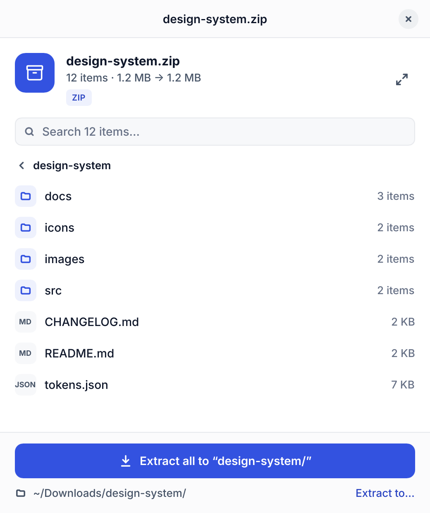
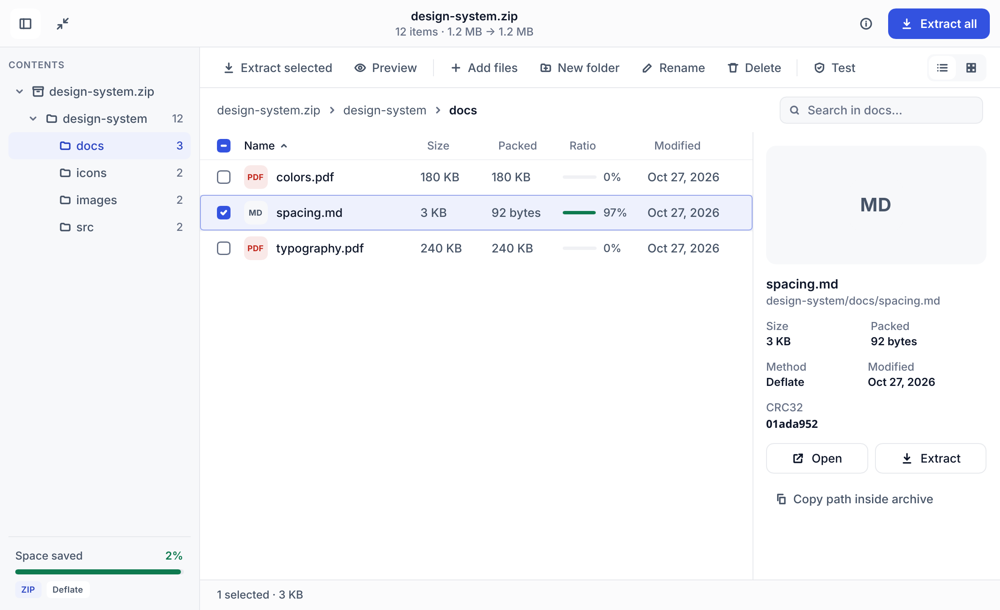
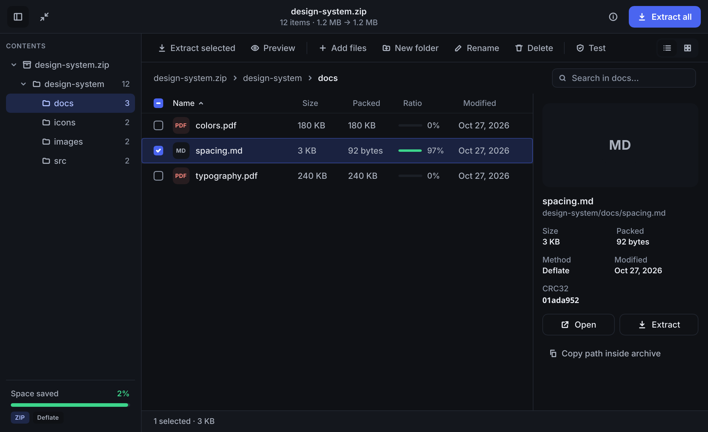
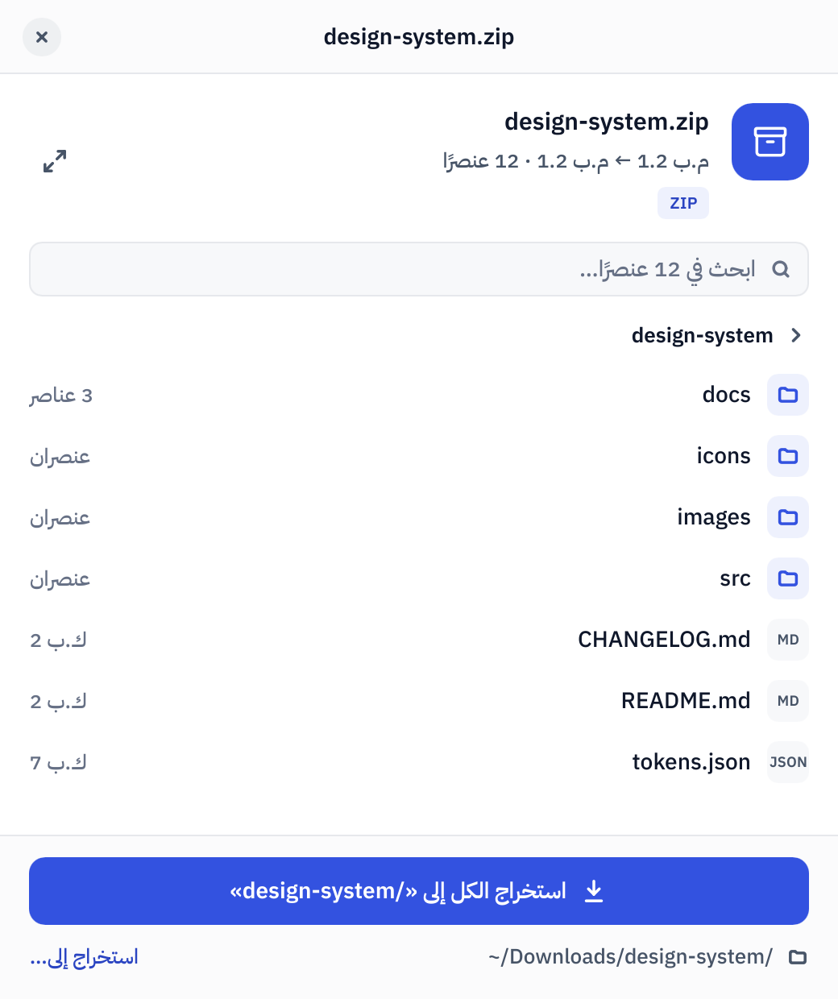
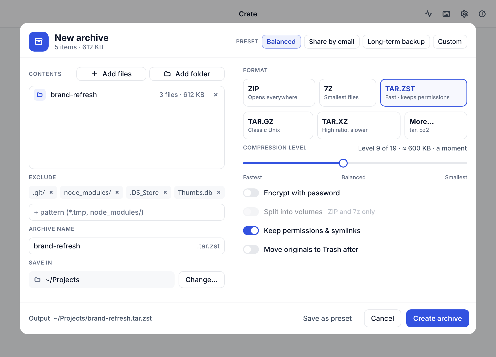

# Crate

A fast, friendly archiver. Double-click a zip, get your files. Written in Rust.

[](https://github.com/mlbrainlab/crate/actions/workflows/ci.yml)
[](https://github.com/mlbrainlab/crate/releases)
[](LICENSE)

[Download](#install) · [Screenshots](#screenshots) · [Contributing](CONTRIBUTING.md) · [Changelog](CHANGELOG.md)

Linux and Windows today; macOS is next on the [roadmap](docs/ROADMAP.md).

## Screenshots

<p>
  
  
</p>
<p>
  
  
</p>
<p>
  
</p>

## Why Crate

- **One click to extract.** Double-click an archive: a small window shows what's inside, with one big Extract button and live progress. The full view browses folders, previews files with Space, and edits the archive in place.
- **Safe by default.** Files that try to escape the folder ("zip-slip"), links pointing outside it and decompression bombs are stopped and reported. An archive is never rewritten in place: the new copy is written next to it, then swapped in.
- **Readable names, any language.** Fixes garbled Arabic, Cyrillic and Japanese names in old ZIPs, and remembers the fix per archive. Full Arabic interface, right to left.
- **The formats you meet.** ZIP, 7z and tar (gz, xz, zst, bz2) to read and write, RAR to read. Split archives (`.7z.001`, `.part1.rar`) with missing-part detection, batch extract, archives inside archives, passwords (AES-256).
- **Fits in.** Light and dark, keyboard shortcuts, screen-reader labels, an Operations panel for long jobs, desktop notifications when one finishes in the background. No account, no tracking.
- **Scriptable.** `crate x photos.zip` uses the same engine from the terminal: list, extract, test, create, add, delete, rename, convert, checksums.

## Install

| Platform | Get it | Notes |
|---|---|---|
| Linux | `.deb`, `.rpm` or AppImage from [Releases](https://github.com/mlbrainlab/crate/releases) | Built on Ubuntu 22.04: runs on Ubuntu 22.04+, Debian 12+, Fedora 38+ and most others. Flathub: coming |
| Windows | `Crate-…-x64-setup.exe` from [Releases](https://github.com/mlbrainlab/crate/releases), from 0.2.0 ([M7](docs/milestones/M7-windows.md)) | Windows 10 and 11. Unsigned: see [below](#windows) |
| macOS | — | Planned ([M8](docs/milestones/M8-macos.md)) |

```bash
sudo apt install ./crate-archiver_*_amd64.deb      # Ubuntu, Debian
sudo dnf install ./crate-archiver-*.x86_64.rpm     # Fedora
chmod +x Crate-*-x86_64.AppImage && ./Crate-*-x86_64.AppImage
```

The packages install `crate-app` (the app) and `crate` (the command-line tool); the AppImage runs the tool with `--cli`. Every release lists SHA-256 checksums in `SHA256SUMS`:

```bash
sha256sum -c SHA256SUMS --ignore-missing
```

To make Crate the default for archives, use the First run screen, or Preferences → "Open these with Crate".

### Windows

The installer needs no administrator rights: it installs for you alone, or for everyone if you choose so on its first page. It adds Crate to "Open with", to Settings → Default apps, and to Explorer's right-click menu (on Windows 11 under "Show more options").

Crate isn't code-signed yet, so the first time you run the installer, Windows SmartScreen says it "prevented an unrecognized app from starting". Click **More info**, then **Run anyway**. To check that the file is the one GitHub Actions built, compare its checksum with the one in `SHA256SUMS`:

```powershell
(Get-FileHash .\Crate-*-x64-setup.exe -Algorithm SHA256).Hash.ToLower()
```

Windows only lets you choose default apps yourself: Crate's First run (or Preferences → "Open these with Crate") opens Settings → Default apps on Crate's page.

## How it's built

| Layer | What |
|---|---|
| App | [Slint](https://slint.dev) UI (`app/ui/*.slint`), Rust controllers; every archive window is its own process |
| `crate-core` | Rust library: listing, extraction through one safety layer, creating, editing, converting, split sets |
| Formats | `zip`, `sevenz-rust2`, `tar` with `flate2` / `liblzma` / `zstd` / `bzip2`, `age` for encrypted tar, UnRAR for RAR |
| CLI | `crate`, the same `crate-core` |

The app and the CLI share `crate-core`, which has no UI code. UI flows are tested headless with Slint's software renderer (they also write the screenshots above).

## Benchmarks

The `crate` CLI against the usual tools, warm cache, with [hyperfine](https://github.com/sharkdp/hyperfine) (5 runs each, mean):

| Task | Crate | Reference |
|---|---|---|
| Extract a 1 GB ZIP (2,000 files, half compressible) | **0.96 s** | `unzip`: 3.37 s |
| Create a 1 GB tar.zst, zstd level 3, synced to disk | **1.99 s** | `tar` + `zstd -T0`: 1.93 s |
| List a tar.gz with 120,000 entries | 0.18 s | `tar -t`: **0.07 s** |

Intel Core i9-14900K (32 threads), NVMe SSD, Ubuntu 26.04, Crate 0.0.6. Crate extracts on all cores; listing does more work than `tar -t` (sizes, dates, name decoding). Reproduce with `scripts/bench-cli.sh`, which generates the data. The app's own startup (archive window on screen with its listing in about 0.1 s warm) is measured in [docs/perf.md](docs/perf.md).

## Build from source

On Ubuntu, Rust (stable, via rustup) and Slint's build dependencies:

```bash
sudo apt install build-essential libfontconfig1-dev libxkbcommon-dev libwayland-dev
```

```bash
cargo run -p crate-app -- <archive>    # an archive in the mini view
cargo run -p crate-app                 # Home
cargo test --workspace                 # all tests
cargo run -p crate-cli -- --help       # the command-line tool
scripts/package-linux.sh               # .deb, .rpm, AppImage into target/dist/
scripts/dev-install-desktop.sh         # "Open With → Crate" for this checkout
```

See [CONTRIBUTING.md](CONTRIBUTING.md) for how the project is organised and how to send changes.

## Support

Crate is free and open source. Stars, bug reports and pull requests help as much as anything.

## License

Crate is [MIT](LICENSE) licensed.

RAR extraction uses the UnRAR library by Alexander Roshal (through the `unrar_sys` crate). UnRAR is freeware, not open source. Its license lets any software use it to extract RAR archives free of charge, but it may not be used to create a RAR-compatible archiver or to recreate the RAR compression algorithm. Crate only reads RAR. The full terms ship with the source of `unrar_sys` (`vendor/unrar/license.txt`). To build without UnRAR, for example for a distribution that only accepts free software, use `cargo build --no-default-features`; RAR files then report "not supported".
